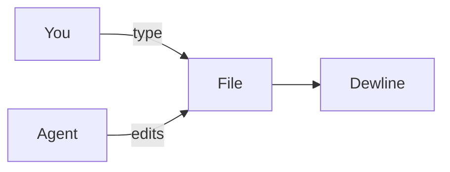

# Welcome to Dewline

Dewline edits plain Markdown files. What you type is saved as text that any app can read. This file is your own copy, so change anything you like.

## Headings

Start a line with `#` for a title, `##` for a section and `###` for a part of a section.

## Emphasis

Wrap words in single stars for *italics* and double stars for **bold**. Backticks make `code`, and two tildes ~~strike text out~~.

## Lists

- A dash starts a list.
- Return continues it, and Tab indents.
  - Like this.

1. Numbers work too.
2. Dewline keeps count.

## Tasks

- [x] Open Dewline
- [ ] Write a note of your own
- [ ] Watch a change land, at the end of this file

## Tables

| Keys | What they do |
| --- | --- |
| ⇧⌘O | Quick Open |
| ⇧⌘P | Command Palette |
| ⌥⌘U | Show the Markdown source |
| ⌘L | Go to a line |

## Callouts

> [!tip]
> A quote that starts with `[!tip]`, `[!note]` or `[!warning]` becomes a callout.

## Wikilinks

Put a note's name in double brackets to link to it, like [[Inbox]].

## Math

Math goes between dollar signs, like $e^{i\pi} + 1 = 0$. Two dollar signs set a formula on its own line:

$$
\int_0^1 x^2 \, dx = \frac{1}{3}
$$

## Diagrams

A fenced block marked `mermaid` draws a diagram:

## Watch a change land

Agents, git and sync apps write to the files you have open. Choose Help > Watch a Change Land (Demo). Dewline writes a short note into this file from outside the editor, the way an agent would, and you see it arrive below.
